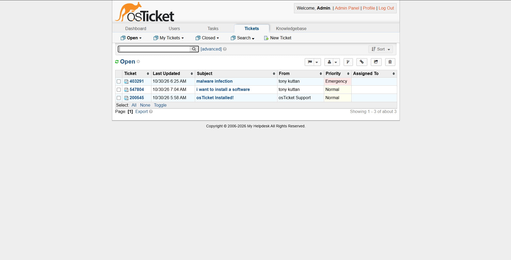
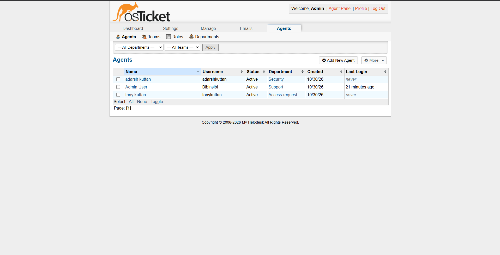
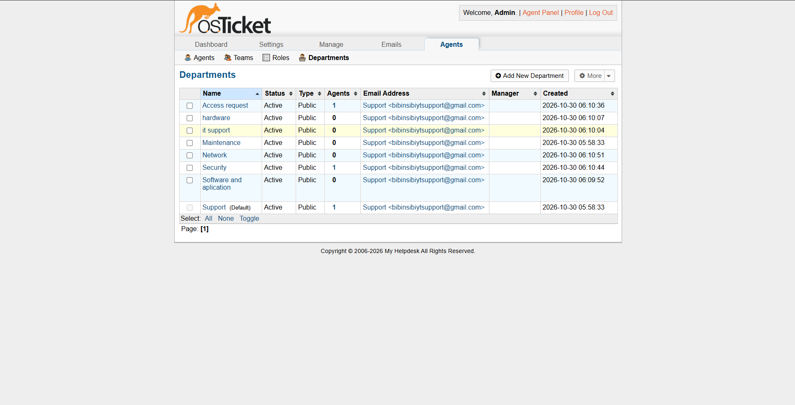
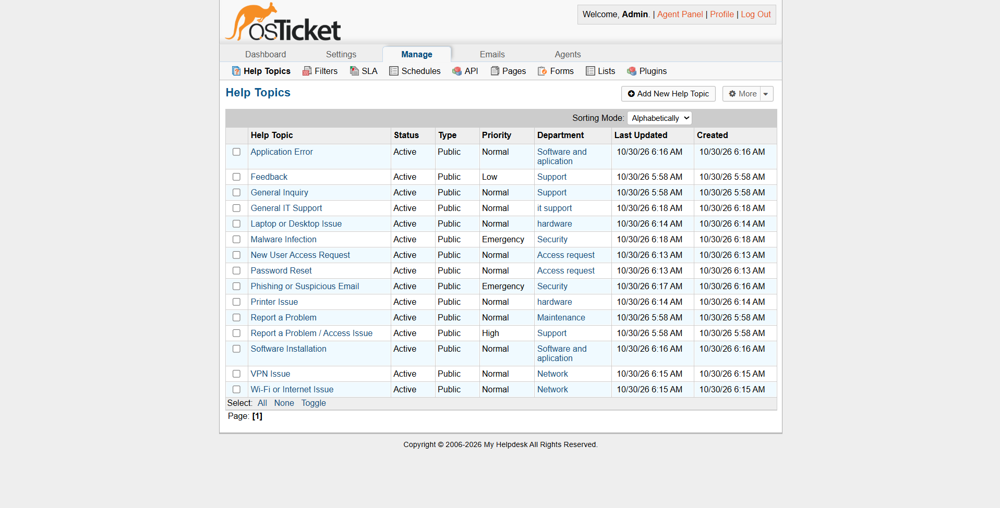
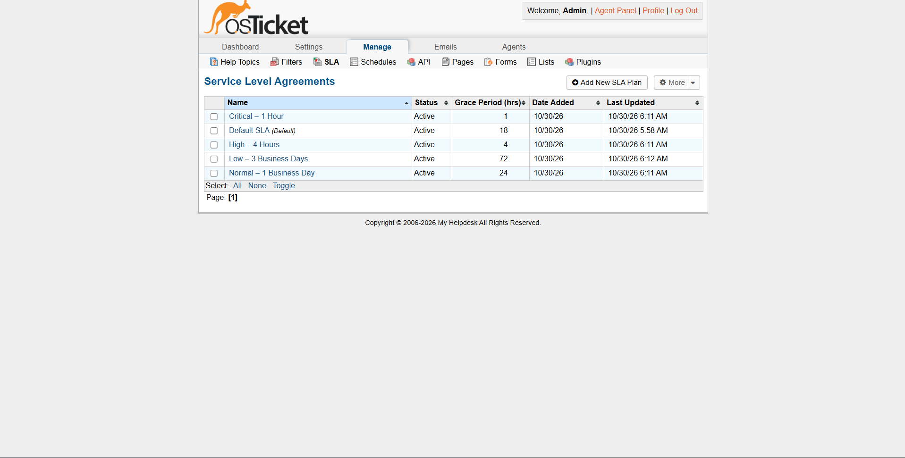

<div align="center">

  <h1>🎫 Dockerized IT Help Desk & ITSM Workflow</h1>
  <p><strong>A containerized IT Service Management platform built with osTicket, MariaDB, Docker Compose, PowerShell automation, and scheduled database backups.</strong></p>

  <p>
    <a href="#-project-overview"></a>
    <a href="#-tech-stack--requirements"></a>
    <a href="#-tech-stack--requirements"></a>
    <a href="#-tech-stack--requirements"></a>
  </p>

  <hr>
</div>

## 📌 Project Overview

This project deploys a containerized IT Help Desk platform using **osTicket**, **MariaDB**, and **Docker Compose**. It simulates a practical Tier 1/Tier 2 IT support environment with department-based ticket routing, SLA policies, role-based access, environment-based secrets, and automated database backups.

The project demonstrates end-to-end IT operations skills: service deployment, secure configuration, help-desk workflow design, troubleshooting, backup automation, and disaster-recovery planning.

---

## ✨ Key Features

<table>
  <tr>
    <td width="50%">
      <h3>🐳 Containerized Deployment</h3>
      <p>osTicket and MariaDB run as isolated Docker Compose services on a dedicated bridge network, with persistent database storage.</p>
    </td>
    <td width="50%">
      <h3>🔒 Secure Configuration</h3>
      <p>Database and administrator credentials are externalized through a Git-ignored <code>.env</code> file instead of being hardcoded in Compose configuration.</p>
    </td>
  </tr>
  <tr>
    <td width="50%">
      <h3>🏷️ Ticket Routing</h3>
      <p>Help Topics classify incoming requests and route them to the appropriate IT department and priority level.</p>
    </td>
    <td width="50%">
      <h3>⏱️ SLA Policies</h3>
      <p>Configurable SLA plans define response and resolution targets for critical, high, normal, and low-priority requests.</p>
    </td>
  </tr>
  <tr>
    <td width="50%">
      <h3>🤖 Backup Automation</h3>
      <p>A PowerShell script and Windows Task Scheduler job create daily timestamped MariaDB backups with automatic 14-backup retention.</p>
    </td>
    <td width="50%">
      <h3>👥 Role-Based Access</h3>
      <p>Administrators and support agents receive department-scoped permissions, separating administrative control from frontline support work.</p>
    </td>
  </tr>
</table>

---

## 🏗️ System Architecture

```text
                       +-----------------------------------+
                       |           Client Browser          |
                       |   http://127.0.0.1:8080           |
                       |   http://127.0.0.1:8080/scp       |
                       +-----------------+-----------------+
                                         |
                                         | HTTP: 8080 -> 80
                                         v
+---------------------------------------------------------------------------+
| Docker Engine                                                             |
|                                                                           |
|  +--------------------------------+     +------------------------------+  |
|  | osTicket Container             |     | MariaDB Container            |  |
|  | Nginx + PHP-FPM + Cron         |     | Persistent database volume   |  |
|  |                                |     |                              |  |
|  | Service: osticket              |====>| Service: mariadb             |  |
|  |                                | TCP | Database: osticket           |  |
|  +--------------------------------+ 3306+------------------------------+  |
|                                                                           |
|  Docker Bridge Network: osticket-net                                      |
+---------------------------------------------------------------------------+
                                         |
                                         | Daily scheduled execution
                                         v
                       +-----------------------------------+
                       |      Windows Task Scheduler       |
                       |      backup-osticket.ps1          |
                       |      C:\osticket-backups\         |
                       +-----------------------------------+
```

---

## 🛠️ Tech Stack

| Layer | Tool / Component | Purpose |
| :--- | :--- | :--- |
| Help Desk | osTicket | Ticketing, departments, SLAs, agents, support workflow |
| Database | MariaDB | Persistent storage for tickets and configuration |
| Containers | Docker Compose | Service orchestration and networking |
| Web Server | Nginx + PHP-FPM | osTicket application runtime |
| Automation | PowerShell | Database backup scripting |
| Scheduler | Windows Task Scheduler | Daily backup execution |
| Security | `.env` + `.gitignore` | Secrets isolation and repository protection |

---

## 🚀 Getting Started

### 1️⃣ Clone the Repository

```bash
git clone [https://github.com/Bibinsibi26/osticket-itsm-workflow.git](https://github.com/Bibinsibi26/osticket-itsm-workflow.git)
cd osticket-itsm-workflow
```

### 2️⃣ Create the Environment File

Create a `.env` file in the project root:

```env
MARIADB_ROOT_PASSWORD=YourUniqueStrongRootPassword
MARIADB_PASSWORD=YourUniqueStrongDatabasePassword
ADMIN_USERNAME=helpdeskadmin
ADMIN_PASSWORD=YourUniqueStrongAdminPassword
```

> [!IMPORTANT]
> Never commit the `.env` file, database files, or SQL backups to GitHub.
>
> Ensure `.gitignore` includes:
>
> ```text
> .env
> mariadb-data/
> *.sql
> ```

### 3️⃣ Start the Stack

```bash
docker compose up -d
```

Check the deployment status:

```bash
docker compose ps
docker compose logs -f osticket
```

Wait until the logs show that the database installation is complete and Nginx/PHP-FPM are running.

### 4️⃣ Access osTicket

| Interface | URL |
| :--- | :--- |
| Support Center | http://127.0.0.1:8080 |
| Submit a Ticket | http://127.0.0.1:8080/open.php |
| Staff / Admin Panel | http://127.0.0.1:8080/scp |

---

## ⚙️ ITSM Workflow

### Departments

| Department | Use Case |
| :--- | :--- |
| IT Support | General Tier 1 technical assistance |
| Hardware | Laptops, desktops, printers, peripherals |
| Network | Wi-Fi, VPN, internet, connectivity issues |
| Software & Applications | Application errors, installations, updates |
| Access Requests | Account creation, permissions, password resets |
| Security | Phishing, malware, suspicious activity |

### SLA Plans

| SLA | Grace Period | Example Use |
| :--- | :---: | :--- |
| Critical | 1 hour | Security incidents, major outages |
| High | 4 hours | Work-blocking hardware or network issues |
| Normal | 24 hours | Software requests and standard support |
| Low | 72 hours | General inquiries and non-urgent requests |

### Ticket Flow

```text
User submits ticket
        |
        v
Help Topic classification
        |
        v
Department routing
        |
        v
SLA deadline applied
        |
        v
Agent works and resolves ticket
        |
        v
Ticket closed and stored in MariaDB
```

---

## 🤖 Automation

This project includes automation for database protection, backup retention, and disaster recovery.

### Daily Database Backups

The `backup-osticket.ps1` script:

- Creates a timestamped SQL dump of the osTicket MariaDB database.
- Runs daily through Windows Task Scheduler.
- Stores backups in `C:\osticket-backups`.
- Uses filenames such as `osticket_2026-10-30_12-27-29.sql`.
- Retains only the latest 14 backups.
- Automatically deletes older backup files.
- Validates that the generated backup is larger than 1 KB.

### Secure Credential Handling

The backup script does not store the MariaDB password in plaintext. It reads the password from the MariaDB container environment:

```powershell
docker exec osticket-db sh -c 'mariadb-dump -h 127.0.0.1 -u osticket -p"$MARIADB_PASSWORD" osticket'
```

This prevents database credentials from being exposed in the PowerShell script or uploaded to GitHub.

### Backup Policy

| Setting | Value |
| :--- | :--- |
| Backup frequency | Daily |
| Backup format | SQL dump |
| Backup location | `C:\osticket-backups` |
| Retention | Latest 14 backups |
| Automatic cleanup | Enabled |
| Credential source | MariaDB container environment |
| Scheduler | Windows Task Scheduler |

### Manual Backup

```powershell
powershell -ExecutionPolicy Bypass -File .\backup-osticket.ps1
```

### Register the Daily Backup Task

Run in an elevated PowerShell window:

```powershell
$action = New-ScheduledTaskAction -Execute "powershell.exe" -Argument '-ExecutionPolicy Bypass -File "C:\osticket-docker\backup-osticket.ps1"'

$trigger = New-ScheduledTaskTrigger -Daily -At 9PM

$settings = New-ScheduledTaskSettingsSet -StartWhenAvailable

Register-ScheduledTask -TaskName "osTicket Daily Database Backup" `
  -Action $action `
  -Trigger $trigger `
  -Settings $settings `
  -Description "Daily backup of the osTicket MariaDB database"
```

### Disaster Recovery

To restore a backup:

```powershell
docker exec -i osticket-db mariadb -h 127.0.0.1 -u osticket -p"$MARIADB_PASSWORD" osticket < "C:\osticket-backups\BACKUP_FILE.sql"
```

This can recover:

- Tickets and ticket threads
- Departments
- Help Topics
- SLA plans
- Agent accounts
- osTicket configuration

---

## 💾 Backup & Disaster Recovery

The backup process protects the osTicket database against accidental deletion, container recreation, or local system failure. Backups are stored outside the Docker project folder and are automatically rotated to prevent uncontrolled disk usage.

A successful backup produces a dated `.sql` file containing the complete osTicket database structure and data.

---

## 🖼️ System Screenshots

<div align="center">

  <h3>🎟️ Open Ticket Queue</h3>
  <p></p>

  <h3>👔 Staff & Agent Directory</h3>
  <p></p>

  <h3>🏢 Department Configuration</h3>
  <p></p>

  <h3>🏷️ Help Topics</h3>
  <p></p>

  <h3>⏱️ SLA Plans</h3>
  <p></p>

</div>

---

## 📄 Operational Commands

<details>
<summary><b>Click to view common Docker commands</b></summary>

<br>

```bash
# Start the stack
docker compose up -d

# Stop the stack while preserving database data
docker compose down

# Restart osTicket
docker compose restart osticket

# View osTicket logs
docker compose logs -f --tail=100 osticket

# View MariaDB logs
docker compose logs -f --tail=100 mariadb

# Create a manual database backup
powershell -ExecutionPolicy Bypass -File .\backup-osticket.ps1
```

</details>

---

## 📈 Future Improvements

- SMTP email integration for ticket notifications
- IMAP email-to-ticket conversion
- Custom ticket fields for asset and location tracking
- Automated ticket assignment rules
- Dashboard reporting for ticket volume and SLA performance
- Off-site or cloud backup storage
- CI/CD-based configuration validation

---

## 👤 Author

<div align="center">

  <h3>Bibin</h3>
  <p><strong>Technical Support & Infrastructure Enthusiast</strong></p>
  <p>
    <a href="https://github.com/Bibinsibi26" target="_blank">
      
    </a>
  </p>

</div>
